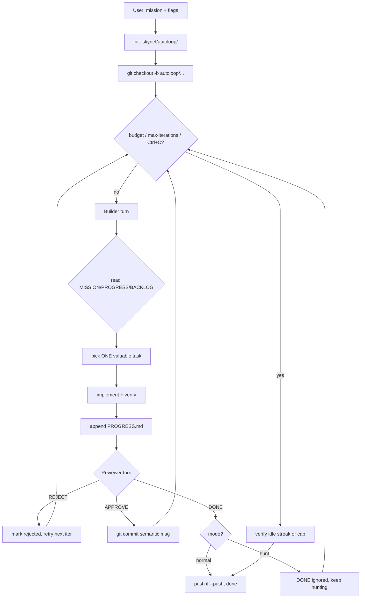

# AutoLoop

AutoLoop is a mission-driven, fully autonomous developer mode for Skynet.
Unlike AutoPilot (fixed plan) and unlike a free-running loop with no
direction, AutoLoop re-evaluates every iteration: what is the single most
valuable thing to fix or build right now?

It works as a duo: a **Builder** agent that scans, picks, implements and
verifies one task, and a **Reviewer** agent that inspects the diff and
commits only if the change is real.

## How it works



## Memory files

AutoLoop persists state on disk, so it survives restarts and context
compaction. All of it lives in `.skynet/autoloop/` under the working
directory (shared across sessions in the same repo):

| File | Purpose |
|---|---|
| `MISSION.md` | The mission you gave. |
| `PROGRESS.md` | One line per iteration outcome. |
| `BACKLOG.md` | Newly discovered work. |
| `BLOCKERS.md` | Things that could not be completed. |

## Modes

- **normal** (default): Reviewer can end the run with `AUTOLOOP_DONE`.
- **hunt** (`--mode hunt`): Reviewer DONE is ignored; the loop keeps
  looking for issues until the budget, iteration cap, Ctrl+C, or 3
  consecutive iterations with no file changes.

## Branching

- Default: new branch `autoloop/<timestamp>`.
- `--branch name`: use an existing branch or create it.
- `--branch main`: commit directly to main (no isolation).
- `--push`: push the branch when the run finishes.

## Usage

```bash
skynet autoloop "make this app production-ready, e2e tested, i18n complete" \
  --branch autoloop/prod-ready --budget 2h --max-iterations 30

skynet autoloop "hunt translation gaps, fix root cause, Playwright asserts toggle" \
  --mode hunt --branch autoloop/i18n --max-iterations 0

skynet autoloop --continue "keep going on the same mission"
```

Flags: `--branch`, `--push`, `--no-review`, `--max-iterations`,
`--budget`, `--mode normal|hunt`, `--auto-compact`, `-C/--continue`,
`-s/--session`.

## Safety

- Permissions are auto-approved for the run's session (like `--yolo`).
- Never pushes unless `--push`.
- Stops on 3 idle iterations (no file changes).
- Watchdog: `Ctrl+C` finishes the current turn then exits.
